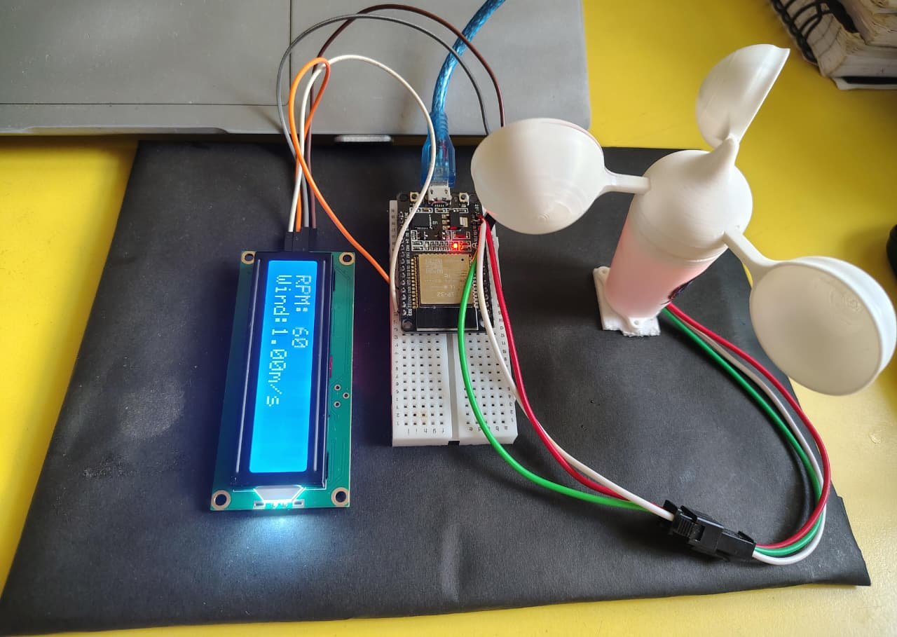
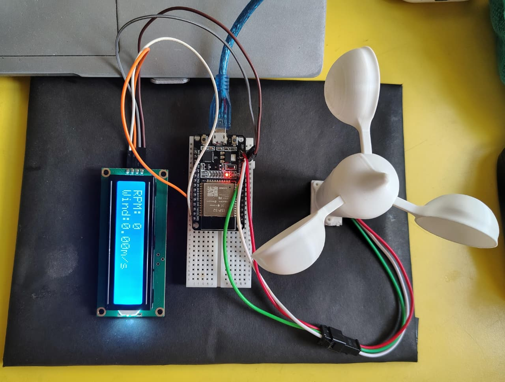

# Digital Wind Speed Measurement System

## About the Project
An ESP32-based Digital Wind Speed Measurement System
using a Hall Effect Anemometer to measure RPM and
wind speed, with real-time readings displayed on
a 16x2 I2C LCD.

## Objectives
- Measure wind speed.
- Calculate RPM.
- Display readings on LCD.
- Develop an IoT-based monitoring system.

## Hardware Components
- ESP32 Development Board
- Hall Effect Anemometer
- 16x2 I2C LCD
- Breadboard
- Jumper Wires
- Power Supply

## Software Used
- Arduino IDE
- Embedded C/C++
- GitHub

## Working Principle
The anemometer rotates with wind.
The Hall Effect sensor generates pulses.
ESP32 counts these pulses and calculates RPM
and wind speed. The readings are displayed
on the LCD.

## Applications
- Weather Monitoring
- Agriculture
- Wind Energy Systems
- Environmental Monitoring
- Smart Weather Stations

 ## Features
- Real-time RPM measurement
- Wind speed calculation
- Hall Effect sensor pulse detection
- Live LCD output
- ESP32-based embedded system
- 
## Future Scope
- Cloud Dashboard Integration
- Wireless Data Monitoring
- Data Logging
- Improved Calibration and Accuracy

## Project Status
Hardware Prototype and Firmware Development.

## Project Gallery

### Complete Hardware Setup

### Anemometer

